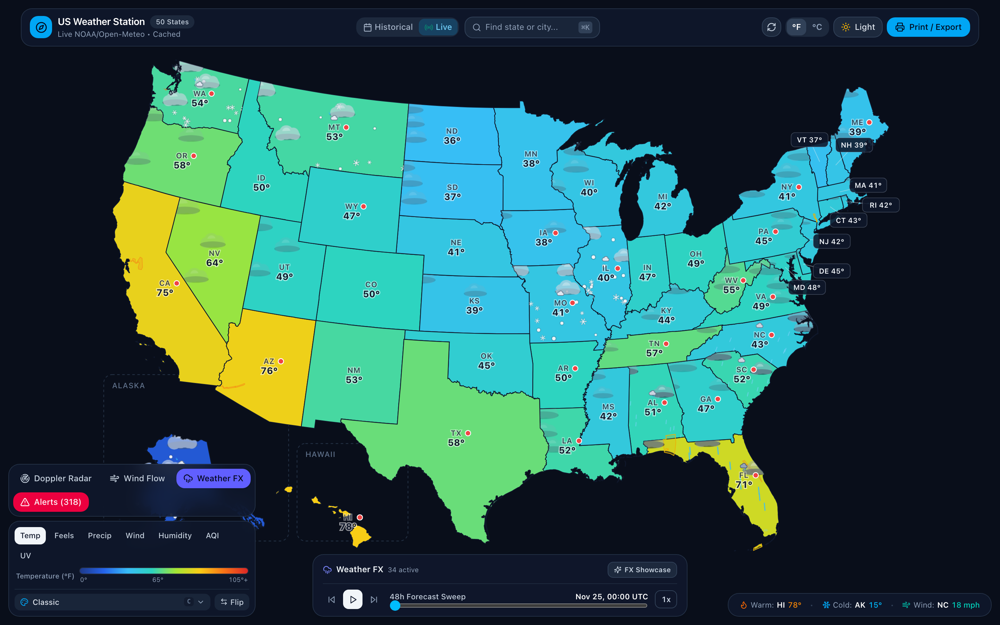
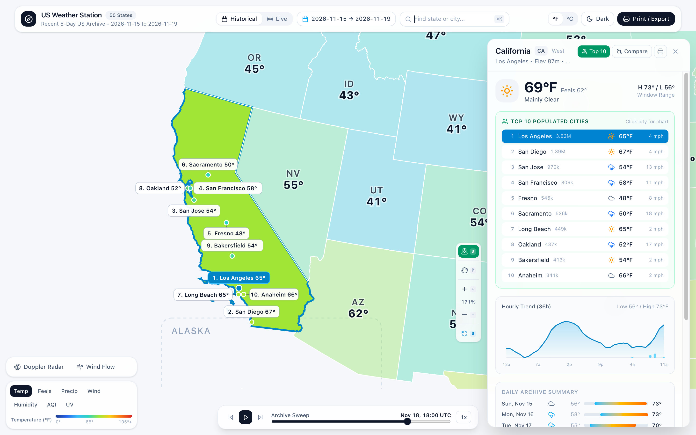

# US Weather Station

Minimalist, interactive 50-state US weather atlas built on the **Bun TypeScript** toolchain. Starts in **Historical Archive** mode with an offline-ready 50-state baseline and switches cleanly to **Live Mode**, animated **Doppler radar**, **wind streamlines**, **Detailed State Mode** (top 10 populated cities), and printable briefings with **zero API keys required**.



## Features

- **50-State Interactive Map** — Albers USA vector map (`d3-geo` + `us-atlas`) with non-overlapping Northeast callouts, hover tooltips, pinned selection tooltips, and Light / Dark themes.
- **Pan, Zoom & Detailed State Mode** — Toggle pan mode (`P` or hold `Space`), zoom from `50%` to `1200%` (`+`/`-`, `0` to reset, or scroll wheel toward cursor), and toggle **Detailed State Mode** (`D`) to auto-zoom into any selected state and populate weather for its **top 10 populated cities** on the map and in the drawer.
- **Historical First, Live Ready** — Boots instantaneously on a real 5-day 50-state historical archive snapshot; explore curated US weather events (e.g., *Jan 2024 Arctic Outbreak*, *Jul 2023 Heat Dome*, *Feb 2021 Deep Freeze*, *2012 Sandy*), custom dates back to 1940, or toggle **Live Mode** (single-batch 50-state query cached via `bun:sqlite`).
- **State Detail Drawer** — Click any state for a pinned summary tooltip, multi-city switcher (including ranked top 10 populated cities in Detailed State Mode), interactive 24–36h temperature & precipitation chart, daily range bars, atmospheric metrics, active NWS severe alerts, and side-by-side state comparison.
- **Broadcast Animations & Doppler Radar** — Pixel-reprojected **NOAA MRMS** (CONUS, Alaska, Hawaii) and **IEM NEXRAD Archive** radar loops, animated wind flow streamlines, and a multi-day weather front timeline scrubber.
- **Print & Export Studio** — Print-formatted 50-state and single-state briefings (`@media print` / PDF), plus CSV, JSON, and 2x PNG map exports.

### Detailed State Mode Preview



## Stack & Data Sources

| Layer | Technology / Source | Notes |
| :--- | :--- | :--- |
| Edge Runtime & API | **Cloudflare Workers**, **Hono**, **Vite 7** (`@cloudflare/vite-plugin`, `wrangler`) | Edge SPA + `/api/*` Worker (also supports local Bun server via `dev:bun`) |
| Frontend | **React 19**, **TypeScript**, **Tailwind CSS v4** (`@tailwindcss/vite`), **d3-geo** | Minimalist glass UI |
| Caching | **Cloudflare Cache API** + isolate memory cache (Workers) / **`bun:sqlite`** (Bun) | Runtime-agnostic [`WeatherCacheStore`](src/server/cacheTypes.ts) |
| Weather & Archive | **Open-Meteo** Forecast, ERA5 Archive & Air Quality APIs | 50-state batched, no key |
| Severe Alerts | **NOAA / NWS** `api.weather.gov` | Active alerts & polygons |
| Doppler Radar | **NOAA OpenGeo MRMS WMS** & **IEM NEXRAD Archive** | Live & historical loops |

## Quickstart

```bash
bun install
bun run dev        # Vite + Cloudflare Workers dev server (requires Node.js for Miniflare)
# or
bun run dev:bun    # Local Bun full-stack dev server (no Node.js required)
```

### Deploy to Cloudflare Workers

```bash
bun run check                  # Typecheck, build client + worker bundles, and dry-run Wrangler deploy
bun run build && bun run deploy # Build and deploy to Cloudflare Workers via Wrangler
```

### Scripts

```bash
bun run dev        # Start Vite + Cloudflare Workers dev server with HMR (requires Node.js)
bun run build      # Typecheck all tsconfig project references and build client + Worker
bun run preview    # Build and preview the production bundle locally
bun run check      # Typecheck, build, and run `wrangler deploy --dry-run`
bun run deploy     # Deploy to Cloudflare Workers
bun run cf-typegen # Regenerate `worker-configuration.d.ts` via `wrangler types`
bun run dev:bun    # Start local Bun.serve dev server with HMR (SQLite cache)
bun run start:bun  # Run local Bun.serve in production mode
bun test           # Run unit, Worker, & API test suite
bun run typecheck  # Run strict TypeScript project-reference checks (`tsc -b`)
bun run seed       # Regenerate the 50-state baseline historical snapshot
```

## Project Structure

```text
index.html         # Vite client entrypoint
vite.config.ts     # Vite + React + Tailwind v4 + @cloudflare/vite-plugin
wrangler.json      # Cloudflare Workers & static assets configuration
src/
├── client/        # React UI, Albers map, radar/wind canvases, print & export views
├── worker/        # Cloudflare Worker Hono entrypoint & Workers cache adapter
├── server/        # Runtime-agnostic API router, data providers, SQLite cache, Bun entrypoint
└── shared/        # Shared TypeScript types, WMO codes, presets, unit formatters
tests/             # Unit, Worker, API router, and CSV exporter tests
```
